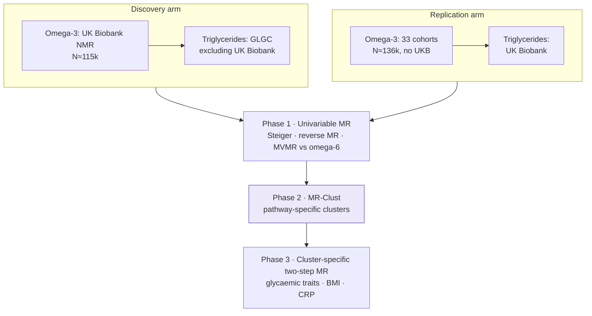

    

> **Status:** manuscript complete; preparing submission to a Q1 journal
>
> This repository is a public overview of an unpublished study. It shows the research question, design and methods. **Results, data and analysis code are withheld until peer-reviewed publication**, and will be released here at that point.

## Research question
Genetic instruments for circulating omega-3 fatty acids act through **several distinct biological pathways**. Do these pathways affect triglycerides differently, and are the effects mediated by glycaemic traits, adiposity or inflammation?

## Study design

## Data sources
| Role | Dataset | Notes |
|---|---|---|
| Exposure | UK Biobank NMR omega-3 (GWAS Catalog) | discovery |
| Exposure | Karjalainen et al. 2024 (33 cohorts) | replication, no UKB |
| Outcome | GLGC 2021 triglycerides (excl. UKB) / UK Biobank TG | no participant overlap within each arm |
| Mediators | MAGIC glycaemic traits, GIANT BMI, CRP | two-step MR |

## Methods
| Component | Approach |
|---|---|
| Instruments | P < 5×10⁻⁸, MAF ≥ 0.01, r² < 0.001 within 10 Mb, F ≥ 10 |
| Univariable MR | IVW (multiplicative random effects), MR-Egger, weighted median, simple/weighted mode |
| Robustness | Cochran Q, Rücker Q′, MR-PRESSO, leave-one-out, Steiger filtering, reverse MR |
| Pathways | MR-Clust (≥4 variants, conditional probability > 0.8) |
| Mediation | cluster-specific two-step MR and MVMR; product-of-coefficients with delta-method SE |

## Why it matters
Omega-3 supplementation trials show mixed cardiovascular results. Separating the genetic pathways that link omega-3 to triglycerides helps explain why, and shows which biology is worth targeting.

## Team & role
**A. R. Soleymani Taloubaghi** (first author: design, analysis, writing) with D. Habibi, M. Akbarzadeh and F. Haghighatdoost.

## Reproducibility
- Analysis pipeline written in R 4.6 (TwoSampleMR, MRPRESSO, mrclust, RadialMR, MVMR), with pinned package versions and a single entry-point script
- Public summary statistics only; no individual-level data is used or shared
- Reported according to STROBE-MR

---
Contact: <a href="mailto:alirezasoleymani24@gmail.com">alirezasoleymani24@gmail.com</a> · <a href="https://aliireezaa.github.io">aliireezaa.github.io</a>
